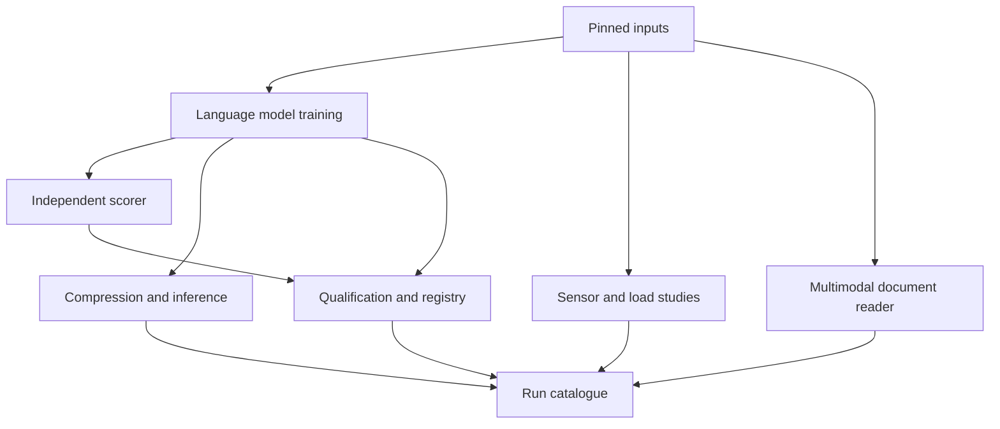

# Machine learning engineering portfolio

An independent, AI-assisted portfolio for engineering teams reviewing how an open model is trained, evaluated, compressed and handed over. A model release can be a decision to hold a candidate. Here the 135M-parameter model improved on a narrow benchmark and still failed the engineering qualification policy.

## Review the evidence

| Project | Result to inspect | Source checkout |
|---|---|---|
| Foundation model post-training | Two runs reproduced the same SFT and DPO adapter hashes. Constrained GRPO and distillation were also executed. | [Post-training](../industrial-foundation-model-engineering/README.md) |
| Engineering evaluation | 14/48 DPO answers correct. A separate evaluation engine agreed. The candidate failed all three performance conditions. | [Evaluation](../engineering-llm-evaluation-framework/README.md) |
| Efficient model serving | Dynamic INT8 reduced P95 CPU latency and lost four correct cases. GGUF Q4_K_M lost one case against F16. | [Serving](../llm-inference-performance-engineering/README.md) |
| Engineering ML | On measured building data the TCN beat persistence. Hand-engineered features beat CNNs on two synthetic condition tasks. | [Maintenance and forecasting](../industrial-predictive-maintenance-ml/README.md) |
| Document intelligence | An OCR, BERT and vision model extracted all fields on 32 controlled synthetic test cards. | [Document reader](../multimodal-engineering-document-intelligence/README.md) |
| Local model lifecycle | A real adapter stopped at testing. SQLite verified signed evidence and MLflow stored a candidate alias. | [Release registry](../sovereign-ai-mlops-platform/README.md) |

Use [DELIVERY.md](DELIVERY.md) for measured test counts, coverage, package status and limitations. The [evidence register](COMPETENCIES.md) covers 121 technical requirements and the vacancy-specific claims. The [assessment and interview roadmap](ASSESSMENT.md) scores the evidence and identifies tasks to reproduce independently. [TRACKER.md](TRACKER.md) records the remaining work.

## Architecture



## Reproduce the CPU integration

Use Linux x86-64 and Python 3.12. The reference environment reported nine logical CPUs, 9.7 GiB of memory, a 20 GiB scratch volume and no NVIDIA device. Models and public data are fetched once. Keep a few GiB available for weights and intermediates, and run heavyweight jobs sequentially on constrained hosts. Install Git and Tesseract with English trained data. From the central index checkout, arrange all six project checkouts beside it.

```bash
python -m venv .venv
source .venv/bin/activate
python -m pip install --index-url https://download.pytorch.org/whl/cpu torch==2.8.0
python -m pip install -c constraints-integrated.txt -r requirements-integrated.txt
python tools/fetch_inputs.py work/inputs smol bert energy
python tools/reproduce.py .. work/inputs work/run-001
```

The integration command requires a fresh output directory. It performs the training and evaluations, runs CPU serving measurements, fits the two main maintenance models, trains the document reader, records the release decision and writes catalogue.json with per-report SHA-256 hashes. Individual project READMEs cover the judge, GGUF, native evaluator and synthetic industrial experiments. Only staging and dependency installation require network access. Optional GPU profiles require different, hardware-specific dependencies.

## Publication

The standalone archive includes seven working trees plus Git bundles, a delivery manifest and a Windows/Linux/macOS-compatible publisher. From the unpacked archive directory, authenticate the GitHub CLI as Pruthvijith with permission to create public repositories, push code and add workflows. The first command checks the account, bundle SHAs and repository names. The second creates repositories, pushes complete history and tags, adds topics and prereleases, then queries workflow status.

```bash
python machine-learning-engineering-portfolio/tools/publish.py .
python machine-learning-engineering-portfolio/tools/publish.py . --publish
```

Use [SECURITY.md](SECURITY.md) for the advisory and deployment boundary. All projects are independent research work. They contain no employer data, aircraft operations, employment metrics or claims of production adoption.
